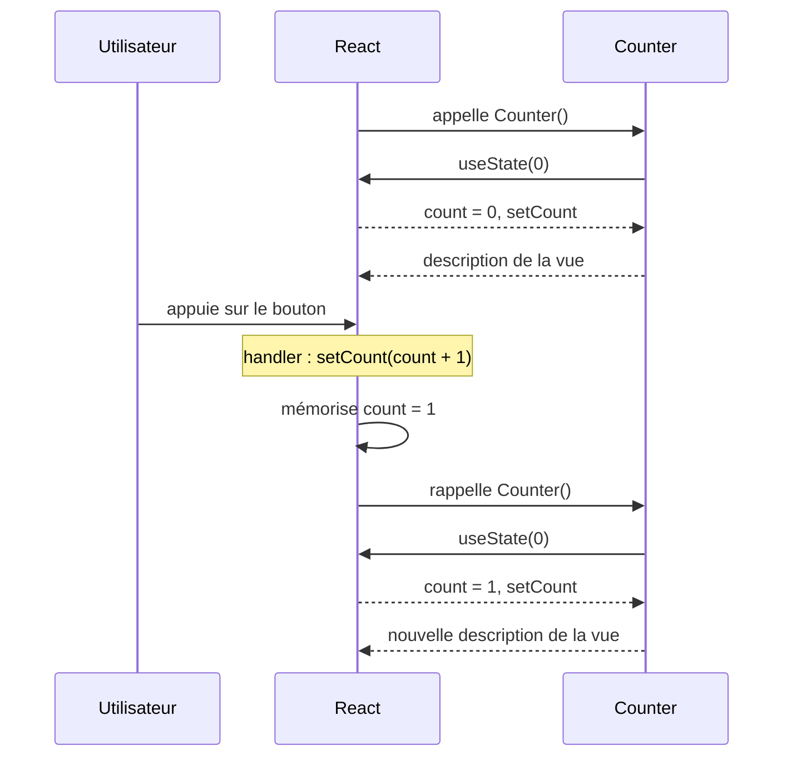
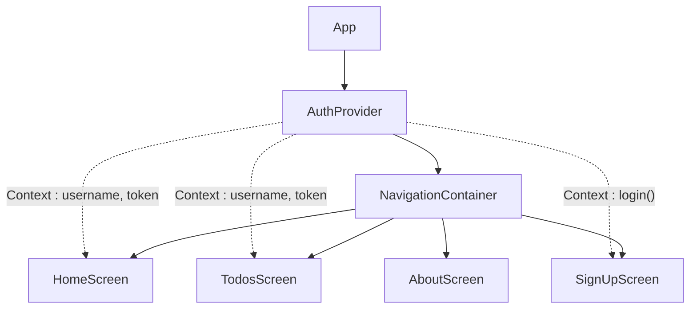
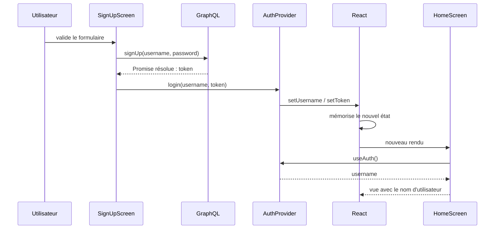

# Gestion de l'état dans React Native

L'*état* (*state*) regroupe les données susceptibles d'évoluer au cours de l'utilisation d'un composant et dont l'évolution doit être prise en compte par React pour mettre à jour l'interface.

Nous distinguerons deux situations :

- L'*état local* concerne un composant particulier. Par exemple, un compteur ou le contenu d'un champ de saisie.
- L'*état global* est partagé entre plusieurs composants de l'application. Par exemple, le nom de l'utilisateur connecté et son jeton d'authentification.

Dans les deux cas, React prend en charge la conservation de l'état et le déclenchement des nouveaux rendus.

## 1. L'état local : le hook `useState`

Une fonction composant ne conserve elle-même aucune variable entre deux rendus : elle est simplement rappelée par React lorsqu'un nouveau rendu est nécessaire.

React peut cependant associer un état persistant à un composant grâce au *hook* (hameçon) `useState`. Les hooks permettent à une fonction composant d'accéder aux fonctionnalités prises en charge par React.

Nous allons réaliser un composant qui compte le nombre d'appuis sur un bouton.

### Déclaration d'un état

Au début du composant, nous écrivons :

```js
const [count, setCount] = useState(0);
```

`useState` retourne une paire composée :

- `count` : la valeur de l'état pour le rendu courant ;
- `setCount` : une fonction permettant de demander à React une mise à jour de cet état.

La valeur `0` est la valeur initiale de l'état. Elle est utilisée par React lors du premier rendu du composant.

Il est important de comprendre que :

```js
setCount(count + 1);
```

ne modifie pas directement la variable `count`. Cette instruction demande à React que la valeur de l'état devienne `count + 1`.

React mémorise cette nouvelle valeur, puis déclenche un nouveau rendu du composant. Lors de ce nouveau rendu, la fonction composant est rappelée et `useState` fournit la nouvelle valeur de `count`.

On retrouve ici le principe d'*inversion de contrôle* : notre code décrit le composant et demande des changements d'état, tandis que React conserve l'état et décide quand rappeler le composant pour mettre à jour l'interface.

### Le composant `Counter`

```jsx
import React, { useState } from "react";
import { Button, Text, View } from "react-native";

export default function Counter() {

    const [count, setCount] = useState(0);

    return (
        <View>
            <Text>Le bouton a été pressé {count} fois</Text>
            <Button
                title="Press me"
                onPress={() => setCount(count + 1)}
            />
        </View>
    );
}
```

Le gestionnaire d'événement :

```js
() => setCount(count + 1)
```

est appelé par React lorsque l'utilisateur appuie sur le bouton. Il demande une modification de l'état, qui entraînera ensuite un nouveau rendu du composant.

Le mécanisme peut être résumé ainsi :



### Grouper plusieurs composants

Le composant contient deux composants natifs, `Text` et `Button`. Ils sont regroupés dans un composant `View`, qui joue notamment le rôle de conteneur.

Lorsque l'on souhaite uniquement grouper plusieurs composants sans ajouter de `View`, on peut utiliser un *fragment* :

```jsx
<React.Fragment>
    <Text>Le bouton a été pressé {count} fois</Text>
    <Button
        title="Press me"
        onPress={() => setCount(count + 1)}
    />
</React.Fragment>
```

ou sa syntaxe concise :

```jsx
<>
    <Text>Le bouton a été pressé {count} fois</Text>
    <Button
        title="Press me"
        onPress={() => setCount(count + 1)}
    />
</>
```

### Portée de l'état local

L'état `count` appartient à une instance du composant `Counter`.

Si nous affichons deux compteurs :

```jsx
<View>
    <Counter />
    <Counter />
</View>
```

chaque compteur possède son propre état, conservé séparément par React.

Un appui sur le premier compteur ne modifie pas le second.

C'est le principe de l'*état local*.

## 2. Pourquoi partager un état ?

Considérons maintenant notre application, composée de plusieurs écrans :

```text
App
 ├── HomeScreen
 ├── TodosScreen
 ├── SignUpScreen
 └── AboutScreen
```

Nous souhaitons permettre à l'utilisateur de s'inscrire auprès du serveur GraphQL.

Après une inscription réussie, le serveur retourne un jeton d'authentification (*JWT*).

Nous souhaitons conserver deux informations :

```js
username
token
```

Ces données doivent être accessibles depuis plusieurs écrans :

- `SignUpScreen` enregistre le nom d'utilisateur et le jeton reçus après l'inscription ;
- `HomeScreen` affiche le nom de l'utilisateur connecté ;
- `TodosScreen` utilise le jeton pour effectuer des requêtes GraphQL authentifiées.

Nous pourrions placer ces informations dans `App` et les transmettre à chaque composant au moyen des *props*.

Mais cela nécessiterait de transmettre les données à travers plusieurs niveaux de composants, y compris ceux qui n'en ont pas besoin.

React propose un mécanisme pour éviter cela : le *Context*.

## 3. L'état partagé : `createContext` et `useContext`

Un *Context* permet de rendre des données accessibles à plusieurs composants sans les transmettre explicitement par les props.

Le principe repose sur trois éléments :

- `createContext` crée un contexte ;
- un `Provider` fournit une valeur aux composants descendants ;
- `useContext` permet à un composant de récupérer cette valeur.

Attention : le Context ne conserve pas lui-même l'état. Il sert à partager des données. Dans notre exemple, l'état est toujours conservé par React au moyen de `useState`.

### Création de `AuthContext`

Créons le fichier `context/AuthContext.js` :

```jsx
import { createContext, useContext, useState } from "react";

const AuthContext = createContext(null);

export function AuthProvider({ children }) {

    const [username, setUsername] = useState(null);
    const [token, setToken] = useState(null);

    function login(username, token) {
        setUsername(username);
        setToken(token);
    }

    function logout() {
        setUsername(null);
        setToken(null);
    }

    return (
        <AuthContext.Provider
            value={{ username, token, login, logout }}
        >
            {children}
        </AuthContext.Provider>
    );
}

export function useAuth() {
    return useContext(AuthContext);
}
```

Examinons ce code.

### Le composant `AuthProvider`

`AuthProvider` est un composant React ordinaire qui utilise deux états locaux :

```js
const [username, setUsername] = useState(null);
const [token, setToken] = useState(null);
```

Il définit également deux fonctions :

```js
function login(username, token) {
    setUsername(username);
    setToken(token);
}

function logout() {
    setUsername(null);
    setToken(null);
}
```

Ces fonctions permettent de demander à React de modifier l'état d'authentification.

Enfin, le composant retourne :

```jsx
<AuthContext.Provider
    value={{ username, token, login, logout }}
>
    {children}
</AuthContext.Provider>
```

La propriété `value` contient les données et les fonctions que nous souhaitons partager.

La propriété `children` représente les composants placés à l'intérieur de `AuthProvider`.

### Le hook personnalisé `useAuth`

Nous définissons :

```js
export function useAuth() {
    return useContext(AuthContext);
}
```

Cette fonction est un *hook personnalisé*.

Elle permet à n'importe quel composant descendant de récupérer les informations partagées :

```js
const auth = useAuth();
```

ou directement :

```js
const { username, token, login, logout } = useAuth();
```

Cette dernière écriture utilise la *déstructuration* d'un objet JavaScript.

## 4. Installer le contexte dans l'application

Dans `App.js`, nous plaçons `AuthProvider` au-dessus de notre navigateur :

```jsx
export default function App() {

    return (
        <AuthProvider>
            <NavigationContainer>
                <Tab.Navigator>
                    <Tab.Screen name="Home" component={HomeScreen} />
                    <Tab.Screen name="Todos" component={TodosScreen} />
                    <Tab.Screen name="SignUp" component={SignUpScreen} />
                    <Tab.Screen name="About" component={AboutScreen} />
                </Tab.Navigator>
            </NavigationContainer>
        </AuthProvider>
    );
}
```

Il faut naturellement importer `AuthProvider` :

```js
import { AuthProvider } from "./context/AuthContext";
```

Le contexte est maintenant accessible à tous les écrans de l'application.



Le fait de placer `AuthProvider` au sommet de l'application permet de conserver l'état d'authentification lorsque l'utilisateur change d'écran.

## 5. Modifier l'état partagé depuis `SignUpScreen`

Notre application dispose d'une API GraphQL permettant de créer un utilisateur :

```js
signUp(username, password)
```

Cette fonction effectue une requête HTTP et retourne une Promise contenant le JWT lorsque l'inscription réussit.

Dans `SignUpScreen`, nous récupérons les fonctions du contexte :

```js
const { login } = useAuth();
```

Puis, dans le gestionnaire d'événement :

```js
function handleSignUp() {

    setMessage("Inscription en cours...");

    signUp(username, password)
        .then(token => {
            login(username, token);
            setMessage("Inscription réussie !");
        })
        .catch(error => {
            setMessage(error.message);
        });
}
```

Nous distinguons ici deux mécanismes :

1. `signUp` effectue une opération réseau asynchrone et retourne une Promise.
2. `login` demande à React de mettre à jour les états `username` et `token` conservés dans `AuthProvider`.

La mise à jour du contexte provoque ensuite un nouveau rendu des composants qui utilisent les données modifiées.

## 6. Lire l'état partagé depuis `HomeScreen`

Dans `HomeScreen`, nous récupérons le nom de l'utilisateur connecté :

```jsx
import { useAuth } from "../context/AuthContext";
```

Puis :

```jsx
export default function HomeScreen({ navigation }) {

    const { username } = useAuth();

    return (
        <View style={styles.container}>

            <Text style={styles.title}>
                Mon application
            </Text>

            <Text>
                {username
                    ? `Bienvenue ${username} !`
                    : "Bienvenue ! Vous n'êtes pas connecté."}
            </Text>

            <Counter />

            <Button
                title="Voir les tâches"
                onPress={() => navigation.navigate("Todos")}
            />

        </View>
    );
}
```

Le composant `HomeScreen` ne reçoit pas `username` par ses props.

Il le récupère directement dans le contexte partagé.

Lorsque `SignUpScreen` appelle :

```js
login(username, token);
```

React met à jour l'état de `AuthProvider`.

Le composant `HomeScreen` reçoit alors automatiquement la nouvelle valeur de `username` lors de son prochain rendu.

Il n'est pas nécessaire de lui transmettre explicitement cette information ni de demander son rafraîchissement.

## 7. État local et état global : synthèse

Nous disposons maintenant de deux formes d'utilisation de l'état React.

| | État local | État partagé |
|---|---|---|
| Exemple | `count` | `username`, `token` |
| Propriétaire | `Counter` | `AuthProvider` |
| Conservation | React | React |
| Déclaration | `useState` | `useState` |
| Accès | Dans le composant | `useContext` |
| Mise à jour | `setCount` | `login`, `logout` |
| Portée | Instance du composant | Composants descendants du Provider |

L'état global n'est donc pas une catégorie particulière d'état React : c'est un état ordinaire, placé dans un composant suffisamment haut dans l'arbre et partagé avec ses descendants.

On peut résumer le mécanisme :



## 8. Limites du Context

Le Context permet de partager un état, mais ne le rend pas persistant entre deux lancements de l'application.

Dans notre exemple, le JWT reste uniquement en mémoire. Si l'application est redémarrée, l'utilisateur devra se reconnecter.

Une application destinée à être déployée devra conserver le jeton dans un stockage sécurisé adapté à la plateforme.

Par ailleurs, le Context ne remplace pas les mécanismes de gestion des transitions d'état. Lorsque le modèle devient plus complexe, nous pouvons utiliser `useReducer` pour décrire explicitement les modifications possibles.

Nous verrons ainsi dans la prochaine séance comment représenter l'évolution d'un modèle à partir d'*actions*, dans une architecture MVC fonctionnelle.