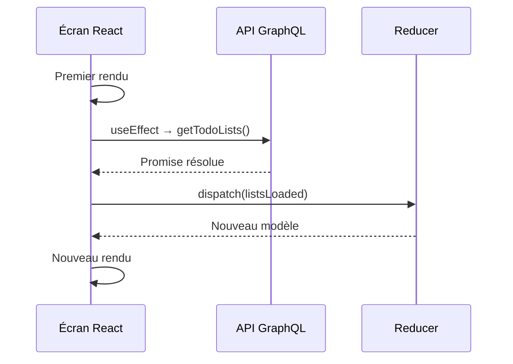
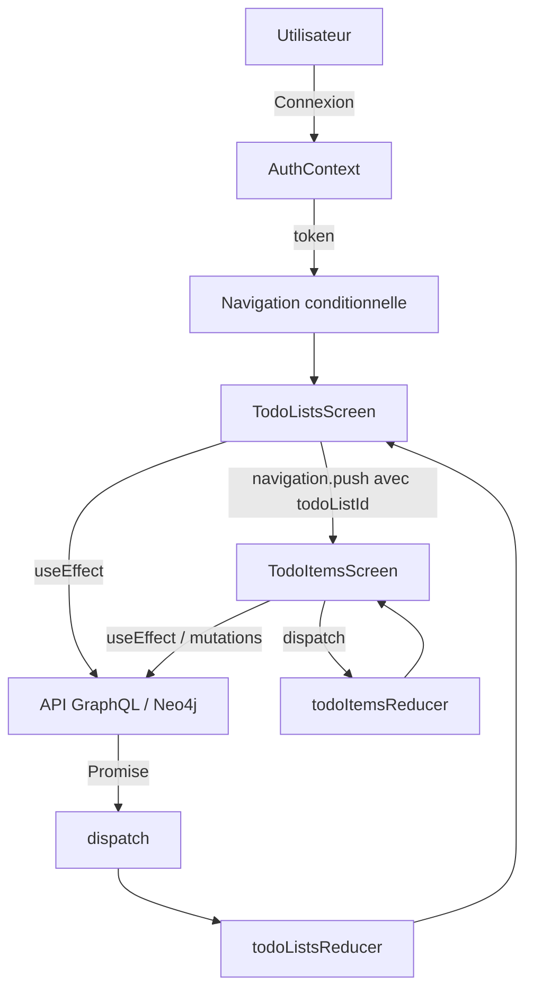

# Navigation conditionnelle

L'application propose deux ensembles d'écrans :

- sans authentification : `SignUp`, `SignIn` ;
- avec authentification : `Home`, `Todos`, `Logout`.

Le contexte `AuthContext` partage `username`, `token`, `login` et `logout`. La navigation dépend directement de `token` :

```jsx
function AppNavigator() {
    const { token } = useAuth();

    return (
        <NavigationContainer>
            <Tab.Navigator>
                {token == null ? (
                    <>
                        <Tab.Screen name="SignUp" component={SignUpScreen} />
                        <Tab.Screen name="SignIn" component={SignInScreen} />
                    </>
                ) : (
                    <>
                        <Tab.Screen name="Home" component={HomeScreen} />
                        <Tab.Screen
                            name="Todos"
                            component={TodosStack}
                            options={{ headerShown: false }}
                        />
                        <Tab.Screen name="Logout" component={LogoutScreen} />
                    </>
                )}
            </Tab.Navigator>
        </NavigationContainer>
    );
}

export default function App() {
  return (
    <AuthProvider>
      <AppNavigator />
    </AuthProvider>
  );
}
```

Noter que l'`AppNavigator` doit accéder au token et doit être défini dans un composant enfant du provider : il n'est pas possible de le définir dans le composant `App`, car c'est lui qui introduit le provider.

Après `login(username, token)`, le contexte change. React effectue un nouveau rendu et les écrans disponibles changent automatiquement : aucun `navigation.navigate()` n'est nécessaire pour passer de l'espace public à l'espace authentifié.

## Le hook `useEffect()`

Le *hook* `useEffect()` permet de déclencher l'exécution d'une fonction après le rendu d'un composant React.

Il est constitué de deux éléments :

- une *fonction* à exécuter, appelée *effet* ;
- une liste optionnelle de dépendances dont la modification déclenchera une nouvelle exécution de cette fonction.

Il permet ainsi de gérer certains aspects du *cycle de vie* d'un composant : son initialisation, ses mises à jour et sa disparition.

### À chaque rendu du composant

Sans liste de dépendances, l'effet est exécuté après chaque rendu.

```jsx
function MonComposant() {
    useEffect(() => {
        // Exécuté après chaque rendu du composant
    });
}
```

### À l'initialisation du composant

Avec une liste de dépendances vide, l'effet est exécuté après le premier rendu (*montage*).

```jsx
function MonComposant() {
    useEffect(() => {
        // Exécuté après le premier rendu
    }, []);
}
```

### Lorsqu'une variable est modifiée

En indiquant une ou plusieurs dépendances, l'effet est exécuté après le premier rendu, puis chaque fois qu'une de ces dépendances change.

```jsx
function MonComposant(props) {

    const [done, setDone] = useState(props.item.done);

    useEffect(() => {
        setDone(props.item.done);
    }, [props.item.done]);

}
```

Dans cet exemple, l'état local `done` est synchronisé avec la propriété `props.item.done`.

Remarque : cet exemple illustre le mécanisme des dépendances. Dans une application réelle, il serait généralement préférable d'utiliser directement `props.item.done` plutôt que de dupliquer cette information dans un état local.

### À la disparition du composant

La fonction passée à `useEffect` peut retourner une fonction de nettoyage (*cleanup*).

```jsx
function MonComposant() {

    useEffect(() => {

        // Initialisation

        return () => {
            // Nettoyage
        };

    }, []);
}
```

Cette fonction est appelée lors du démontage du composant. Elle est également appelée avant une nouvelle exécution de l'effet lorsque ses dépendances changent.

Elle permet notamment de libérer des ressources ou de supprimer des abonnements à des événements.

### Application : connexion à une API

Dans notre application Todo, `useEffect` permet de charger les tâches lorsque l'écran est initialisé ou lorsqu'une autre liste est sélectionnée.

```jsx
useEffect(() => {

    getTodos(todoListId, token)
        .then(items => {
            dispatch({
                type: "itemsLoaded",
                items
            });
        });

}, [todoListId, token]);
```

La requête est déclenchée après le premier rendu, puis lorsque `todoListId` ou `token` change.

Lorsque la promesse est résolue, `dispatch` transmet les données au reducer, qui actualise le modèle et provoque un nouveau rendu.

L'intérêt de `useEffect` est donc de séparer les *effets de bord* (requêtes réseau, abonnements, etc.) du calcul de l'interface React.

## Connexion à l'API avec `useEffect`

### Rendu et effets de bord

Un composant React peut être exécuté plusieurs fois. Il ne faut donc pas lancer une requête réseau directement dans le corps du composant :

```jsx
// À éviter : requête déclenchée pendant le rendu.
function TodoListsScreen() {
    getTodoLists(username, token);
    return <View />;
}
```

`useEffect` permet de synchroniser le composant avec un système extérieur :

```jsx
useEffect(() => {
    getTodoLists(username, token)
        .then(lists => {
            dispatch({ type: "listsLoaded", lists });
        });
}, [username, token]);
```

L'effet s'exécute après le rendu initial et lorsque l'une de ses dépendances change. En développement, le mode Strict peut provoquer une exécution supplémentaire pour tester le nettoyage.

### Chargement, erreurs et nettoyage

```jsx
useEffect(() => {
    let active = true;

    setLoading(true);
    setError(null);

    getTodoLists(username, token)
        .then(lists => {
            if (active) {
                dispatch({ type: "listsLoaded", lists });
            }
        })
        .catch(error => {
            if (active) setError(error.message);
        })
        .finally(() => {
            if (active) setLoading(false);
        });

    return () => {
        active = false;
    };
}, [username, token]);
```

La fonction de nettoyage empêche ici de traiter une réponse devenue obsolète ; elle n'annule pas la requête HTTP.

### Cycle de chargement



## Un reducer par type de modèle

Notre domaine métier comporte deux types d'objets : `TodoList` et `TodoItem`. Chaque collection possède ses propres transitions d'état.

### Reducer des listes

```js
export const initialTodoLists = [];

export function todoListsReducer(model, action) {
    switch (action.type) {
        case "listsLoaded":
            return action.lists;

        case "listAdded":
            return [...model, action.list];

        case "listDeleted":
            return model.filter(list => list.id !== action.id);

        default:
            return model;
    }
}
```

### Reducer des tâches

```js
export const initialTodoItems = [];

export function todoItemsReducer(model, action) {
    switch (action.type) {
        case "itemsLoaded":
            return action.items;

        case "itemAdded":
            return [...model, action.item];

        case "itemToggled":
            return model.map(item =>
                item.id === action.id
                    ? { ...item, done: !item.done }
                    : item
            );

        case "itemDeleted":
            return model.filter(item => item.id !== action.id);

        default:
            return model;
    }
}
```

Chaque écran initialise son modèle :

```jsx
const [lists, dispatch] = useReducer(todoListsReducer, initialTodoLists);
// ou, dans l'autre écran :
const [items, dispatch] = useReducer(todoItemsReducer, initialTodoItems);
```

### Le reducer reste pur

Un reducer calcule le prochain état à partir de l'état courant et d'une action :

\[
M_{t+1} = R(M_t, a_t)
\]

Il n'effectue aucune requête réseau. La mutation distante est déclenchée par le gestionnaire d'événement ; l'action locale suit la confirmation du serveur :

```js
function handleToggle(item) {
    updateTodo(item.id, !item.done, token)
        .then(updatedItem => {
            dispatch({
                type: "itemToggled",
                id: updatedItem.id
            });
        })
        .catch(error => setError(error.message));
}
```

### Trois catégories d'état

| Catégorie | Exemples | Mécanisme |
|---|---|---|
| État partagé | `username`, `token` | `useContext` |
| Modèle métier | `lists`, `items` | `useReducer` |
| État local d'interface | `content`, `loading`, `error`, `pendingIds` | `useState` |

## Navigation hiérarchique : `Stack.Navigator`

Une liste contient plusieurs tâches. Nous souhaitons donc passer de `TodoListsScreen` à `TodoItemsScreen`, puis revenir en arrière.

### Définition de la pile

Dans `App.js` :

```jsx
import { createNativeStackNavigator } from "@react-navigation/native-stack";

const Stack = createNativeStackNavigator();

function TodosStack() {
    return (
        <Stack.Navigator>
            <Stack.Screen
                name="TodoLists"
                component={TodoListsScreen}
                options={{ title: "Mes listes" }}
            />
            <Stack.Screen
                name="TodoItems"
                component={TodoItemsScreen}
                options={{ title: "Tâches" }}
            />
        </Stack.Navigator>
    );
}
```

`TodosStack` est lui-même affiché dans l'onglet `Todos` du `Tab.Navigator`. Les deux navigateurs sont donc imbriqués.

### Passage de paramètres

Depuis `TodoListsScreen` :

```js
function handleSelect(list) {
    navigation.push("TodoItems", {
        todoListId: list.id,
        title: list.title
    });
}
```

Dans `TodoItemsScreen` :

```jsx
export default function TodoItemsScreen({ route }) {
    const { todoListId, title } = route.params;
    const { token } = useAuth();

    // Initialisation du reducer, de l'état local, etc.
}
```

L'identifiant reçu permet de charger uniquement les tâches de la liste sélectionnée :

```jsx
useEffect(() => {
    getTodos(todoListId, token)
        .then(items => {
            dispatch({ type: "itemsLoaded", items });
        });
}, [todoListId, token]);
```

## Synthèse : circulation de l'information



Trois circulations complémentaires structurent l'application :

- **Descendante :** les propriétés et les contextes transmettent les données aux composants.
- **Événementielle :** les interactions déclenchent des opérations et des actions.
- **Asynchrone :** les promesses issues de l'API produisent des résultats qui entraînent des transitions d'état.

Le principe central est le suivant : **les composants décrivent l'interface à partir de l'état ; les événements et les effets provoquent les transitions de cet état.**
