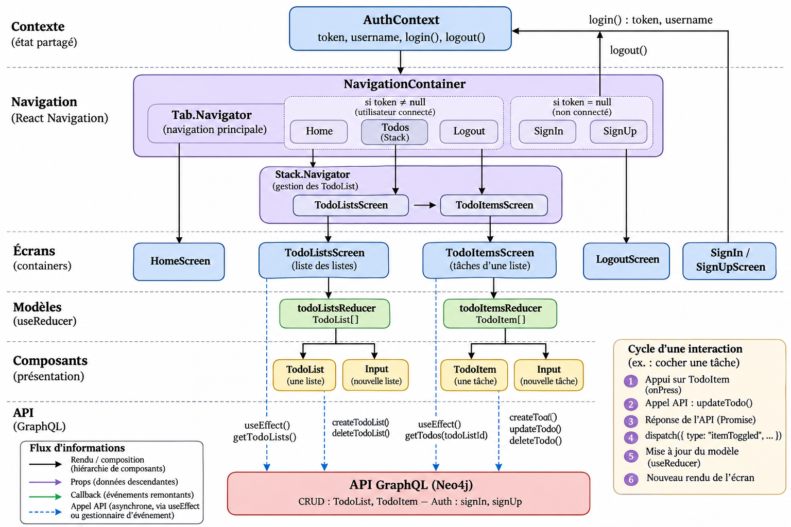

# Conception générale d'une application React

*Au fil de cette présentation, nous considérons la réalisation d'une application de gestion de TodoLists, en liaison avec une API CRUD appelée par des requêtes GraphQL.*

Lorsqu'on conçoit une application React, il convient d'organiser les différents flux d'informations entre les composants.

L'application est constituée d'une hiérarchie de composants qui communiquent par l'intermédiaire de propriétés (*props*), de contextes et de fonctions de gestion des événements.

## 1. Définir le contexte

La première chose à décider concerne les informations qui doivent être partagées entre plusieurs composants, indépendamment de leur position dans la hiérarchie.

Ces informations sont placées dans un *contexte* React, accessible avec le hook `useContext()`.

Dans notre application, le contexte d'authentification contient :

* `username` : le nom de l'utilisateur connecté ;
* `token` : le jeton JWT utilisé pour accéder à l'API ;
* `login()` et `logout()` : les fonctions permettant de modifier l'état d'authentification.

Le contexte permet notamment de mettre en œuvre une navigation conditionnelle : selon la présence du jeton, l'application affiche les écrans de connexion ou les écrans réservés à l'utilisateur authentifié.

## 2. Organiser les écrans et la navigation

Les écrans constituent les principaux niveaux de l'application.

Nous distinguons deux mécanismes de navigation :

* `Tab.Navigator` permet de passer d'une fonctionnalité à une autre : `Home`, `Todos`, `Logout` ;
* `Stack.Navigator` permet de naviguer entre des écrans hiérarchiquement liés.

Dans notre application, l'onglet `Todos` contient une pile de navigation :

```text
Tab.Navigator
├── Home
├── Todos
│   └── Stack.Navigator
│       ├── TodoListsScreen
│       └── TodoItemsScreen
└── Logout
```

Les écrans `SignIn` et `SignUp` remplacent ces onglets lorsque l'utilisateur n'est pas authentifié.

La sélection d'une liste dans `TodoListsScreen` provoque l'affichage de `TodoItemsScreen`, auquel on transmet l'identifiant de la liste sélectionnée.

## 3. Définir les modèles et les variables d'état

Il faut ensuite déterminer quelles informations sont conservées dans chaque composant et à quel niveau elles doivent être définies.

Nous distinguons trois catégories d'état :

* les informations partagées entre plusieurs écrans, placées dans un contexte (`useContext`) ;
* les données métier, gérées par un modèle et un reducer (`useReducer`) ;
* les informations propres à l'interface, gérées par des variables d'état locales (`useState`).

Les variables d'état et les fonctions permettant de les modifier peuvent être transmises aux composants enfants par l'intermédiaire des *props*.

Elles doivent donc être définies dans un composant suffisamment haut dans la hiérarchie pour être accessibles à tous les composants qui en ont besoin.

Dans notre application, nous avons deux modèles métier :

* `TodoList` : l'ensemble des listes de tâches ;
* `TodoItem` : les tâches appartenant à une liste.

Chaque modèle possède son propre reducer :

```js
const [lists, dispatch] = useReducer(
    todoListsReducer,
    initialTodoLists
);
```

```js
const [items, dispatch] = useReducer(
    todoItemsReducer,
    initialTodoItems
);
```

Cette organisation permet de séparer les opérations sur les listes des opérations sur les tâches.

Les reducers sont des fonctions pures : ils calculent un nouvel état à partir de l'état précédent et d'une action.

## 4. Organiser les interactions entre composants

Les composants enfants reçoivent les données nécessaires à leur affichage par leurs *props*.

Ils peuvent également recevoir des fonctions permettant de signaler une interaction à leur composant parent.

Par exemple, un composant représentant une tâche peut recevoir :

* un objet `item` contenant les données de la tâche ;
* une fonction `onToggle()` appelée lorsque l'utilisateur clique sur la tâche ;
* une fonction `onDelete()` appelée pour demander sa suppression.

Les données circulent donc du parent vers les enfants, tandis que les interactions sont remontées par l'intermédiaire de fonctions de rappel (*callbacks*).

Ce mécanisme illustre le principe d'*inversion de contrôle* : le composant enfant signale un événement, mais c'est le composant parent qui décide des opérations à effectuer.

## 5. Synchroniser les modèles avec l'API

Les données métier sont conservées sur un serveur distant, accessible par une API GraphQL.

Les écrans doivent donc synchroniser leur modèle local avec les données du serveur.

Cette synchronisation repose sur deux mécanismes :

* `useEffect()` permet de déclencher des opérations lors du cycle de vie du composant, notamment le chargement initial des données ;
* les gestionnaires d'événements déclenchent les mutations de l'API, puis transmettent une action au reducer lorsque l'opération est confirmée.

Par exemple, lorsqu'un utilisateur coche une tâche :

1. le composant déclenche un événement `onPress` ;
2. le gestionnaire appelle l'API pour modifier la tâche ;
3. l'API renvoie une promesse ;
4. lorsque la promesse est résolue, le gestionnaire appelle `dispatch()` ;
5. le reducer calcule le nouveau modèle ;
6. React effectue un nouveau rendu des composants concernés.

Le reducer ne réalise jamais lui-même les appels à l'API : il décrit uniquement les transformations du modèle.

## 6. Représenter la hiérarchie des composants

Pour concevoir cette architecture, il est utile de représenter la hiérarchie des composants et les principaux flux d'informations.

Le schéma suivant distingue :

* le contexte d'authentification ;
* les écrans et leurs relations de navigation ;
* les composants d'affichage ;
* les données transmises par les *props* ;
* les événements remontés par les fonctions de rappel.



Cette représentation permet de déterminer où placer les variables d'état, les reducers et les gestionnaires d'événements, tout en évitant de dupliquer les données dans plusieurs composants.