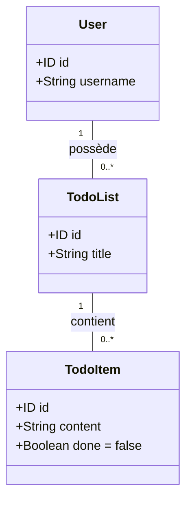

---
author:
- François Rioult
lang: fr
title: React Native - Séance 0
subtitle: Installation en local d'une API Neo4j - GraphQL
---

# Installation en local d'une API Neo4j - GraphQL

La réalisation de notre projet React passe par la mise à disposition d'un endpoint base de données.

On réalise pour cela une pile `Docker` avec :

1. un *container* pour la base de données
1. un container pour le serveur d'API GraphQL pour cette base

Ce choix technologique permet une grande portabilité : 

* VDI Unicaen
* Linux / Windows

# Modèle



## Containers `docker`

Nous utilisons `docker`, une technologie de virtualisation. La notion
de base est celle de `container`, qui font tourner une machine
virtuelle qui utilise les ressources de la machine hôte.

Les containers sont initialisés à partir d'*images* contenant la
technologie nécessaire, par exemple un serveur de bases de données
`mongo`, un serveur web, etc. On peut également créer ses propres
containers à partir d'autres containers.

Pour l'application finale, nous utiliserons plusieurs containers, qui formeront une *pile*\ :

* un serveur `neo4j`
* un serveur `graphQL` pour définir un point d'accès à la base de données (*database endpoint*)

### `docker` sur la VDI Unicaen

Pour exécuter `docker` sur la VDI, vous devez être dans le groupe `docker`. Personne n'est dans ce groupe, il faut en demander le privilège. Chaque commande `docker` ou `docker compose` qui suit doit donc être précédée de `sudo -g docker` (demander des privilèges consistant à être membre du groupe `docker`).

Par exemple, pour faire tourner le container de test `hello-world`\ :

```
sudo -g docker docker run hello-world
```

C'est quand-même très fastidieux de faire précéder toutes vos commandes `docker` de `sudo -g docker`, donc je recommande de créer un *alias*\ :

```
$ alias docker='sudo -g docker docker'
$ alias docker compose='sudo -g docker docker compose'
```

**Attention** : les alias ne fonctionnent pas dans les scripts ! dans un script, `bash` n'interroge pas sa liste d'alias pour exécuter une commande. En revanche, les alias peuvent être paramétrés dans certains scripts.

Pour éviter de définir cet alias à chaque lancement de VDI, vous pouvez créer un script `~/Document/bashrc` contenant cette définition et utiliser `~/Documents/x11_user_startup_jammy-vdi.sh`, qui est exécuté au lancement de la VDI (voir <https://faq-etu.unicaen.fr/x11_user_startup>), pour installer ce `bashrc` à sa bonne place\ : `~/.bashrc`. Voici comment procéder\ :

```bash
$ cat ~/Documents/bashrc
alias docker='sudo -g docker docker'
alias docker compose='sudo -g docker docker compose'
$ cat ~/Documents/x11_user_startup_$USER_STARTUP_SUFFIX.sh
if [ ! -f ~/.bashrc ]; then
  cp -f ~/Documents/bashrc ~/.bashrc
fi
```

### Volumes Docker


Les *volumes* de Docker permettent de faire des liaisons dynamiques
entre le système de fichier de l'hôte (la VDI) et celui du
container. Ainsi, lorsque le container écrit sur son système de
fichiers, c'est en fait sur le système de fichiers de l'hôte que
l'écriture a lieu.

Ce mécanismes de volumes permet de rendre persistantes des
modifications du système de fichier du container. C'est notamment le
cas lorsque le container fait tourner une base de données : il accède
à son système de fichier local. Si les fichiers créés par la base de
données sont sur un volume, les écritures ont en fait lieu sur le
système de fichier de l'hôte.

La sauvegarde des volumes sur l'hôte permet donc d'assurer la
pérennité des données du container.

*Pour simplifier, dans la suite, les volumes seront gérés par Docker.*

*Ne lisez la suite que si vous avez envie de faire des transferts de volumes.*

#### Définition d'un volume sur un répertoire local

Lors de l'exécution d'un container, on indiquera la présence d'un volume, caractérisé par l'association entre un chemin sur le système de fichier local et un chemin dans le container\ :

- si on lance directement le container avec `docker run...`, on utilise l'option `-v` pour préciser l'association\ :

```
docker run -it -v ./backup:/backup-dir --rm bash:4.4
```

- ici, on lance un container nommé `testso` avec l'image `bash`, le volume fait la liaison entre le répertoire `./backup` de l'hôte et le répertoire `/backup-dir` du container

- si on utilise une pile de container, on précise le volume comme suit\ :

```
    volumes:
      - ./backup:/backup-dir
```

N.B. L'utilisation d'un volume local est **vivement déconseillée** sur la VDI. Il est préférable de se tourner vers les solutions décrites ci-dessous (volume externe ou local à une pile). En effet, lorsqu'un container écrit des données dans un volume, il le fait en tant que `root`, éventuellement sans droit de lecture pour *les autres*. Sur le système de fichiers de l'hôte, les fichiers appartiendront également à `root`.

Si votre volume local est dans un sous-dossier de `~/Documents`, le système de fichier Samba qui gère ces dossiers **refusera** la création des fichiers du volume.

Si votre volume est dans `~`, les fichiers créés appartiendront à `root` et vous ne pourrez pas les relire / archiver.

#### Définition d'un volume externe

Docker permet de créer des volumes indépendamment d'un container\ :

```
$ docker volume create mongodata
mongodata
$ docker volume ls
local     mongodata
$ docker volume inspect mongodata
[
    {
        "CreatedAt": "2023-10-05T10:56:30+02:00",
        "Driver": "local",
        "Labels": null,
        "Mountpoint": "/var/lib/docker/volumes/mongodata/_data",
        "Name": "mongodata",
        "Options": null,
        "Scope": "local"
    }
]
```

On constate que Docker gère le volume dans le point de montage `/var/lib/docker/volumes/mongodata/_data`.

On pourra utiliser le volume externe\ :

- lors du lancement d'un container\ :

```
docker run -it -v docker-mongo_mongodata:/data/db --rm bash:4.4
```

Docker comprend que le volume est externe car le chemin sur le système de fichier de l'hôte ne commence ni par `.` ni par `/` (ce n'est ni un chemin relatif ni absolu, c'est donc un volume externe).

- dans une pile de container :

```
services:
  mongo:
    ...
    volumes:
      - mongodata:/data/db
    ...

volumes:
  mongodata:
    external: true
```

Notez que dans la définition de la pile, le volume doit être déclaré
dans la section adéquate.

Enfin, on peut détruire un volume externe par :

```
$ docker volume rm mongodata
```


#### Sauvegarde d'un volume

Pour sauvegarder un volume, il faut\ :

- instancier un container avec ce volume et  y générer un fichier d'archive que l'on souhaite récupérer en local\ : il faut donc un autre volume pour récupérer le fichier d'archive. Une image de `bash` suffira pour ces opérations

```
# créer un répertoire de backup
mkdir backup
# exécuter une image de bash avec deux volumes : l'un est mongodata,
# l'autre sert au backup. L'option --rm permet de détruire le container
# lorsque sa tâche est terminée
docker run --rm -v docker-mongo_mongodata:/data/db -v ./backup:/backup-dir bash:4.4 -c "cd /data/db && tar cvf /backup-dir/mongo.tar ."
```

On dispose donc dans le répertoire `./backup` d'un fichier d'archive `mongo.tar`.

N.B. Il est prudent de préalablement d'éteindre la pile de containers dont on sauvegarde le volume. Cependant, le backup peut être effectué pendant que la pile tourne. Il faudra cependant stopper le container (pour éviter que le gestionnaire de données effectue des opérations)\ :

```
docker stop mongo-dev
```

On peut ensuite procéder au backup, puis relancer le container\ :

```
docker start mongo-dev
```

#### Restauration d'un volume

La restauration est l'opération inverse de la sauvegarde\ : on
instancie un container `bash` avec deux volumes, celui à restaurer et
un volume permettant d'accéder à l'archive\ :

```
docker run --rm -v docker-mongo_mongodata:/data/db -v ./backup:/backup-dir bash:4.4 -c "cd /data/db && tar xvf /backup-dir/mongo.tar"
```

On a supposé ici que le volume `docker-mongo_mongodata` n'existait pas.

#### Contrôle d'un volume

Pour contrôler ce qui se passe dans un volume, il est possible d'instancier une image `bash` intégrant le volume à tester\ :

```
$ docker run -it -v docker-mongo_mongodata:/data/db --rm bash:4.4
bash-4.4# ls
bin    dev    home   media  opt    root   sbin   sys    usr
data   etc    lib    mnt    proc   run    srv    tmp    var
bash-4.4# cd data/db/
bash-4.4# ls
...
```

### Récapitulatif sauvegarde / restauration d'un volume

On considère disposer d'un volume `docker-mongo_mongodata` :

```bash
# démarrer la pile de container mongo
docker compose -f mongo.yml up -d
# insérer les données
docker exec -i mongo-dev sh -c 'mongoimport -d bda -c sales --authenticationDatabase admin -u root -p example' < sales.bson
# éteindre la pile de container
docker compose -f mongo.yml down

# créer un répertoire de backup
mkdir backup
# exécuter une image de bash avec deux volumes : l'un est mongodata,
# l'autre sert au backup. L'option --rm permet de détruire le container
# lorsque sa tâche est terminée
docker run --rm -v docker-mongo_mongodata:/data/db -v ./backup:/backup-dir bash:4.4 -c "cd /data/db && tar cvf /backup-dir/mongo.tar ."

# détruire le volume
docker volume rm docker-mongo_mongodata
# défaire le tar dans le volume
docker run --rm -v docker-mongo_mongodata:/data/db -v ./backup:/backup-dir bash:4.4 -c "cd /data/db && tar xvf /backup-dir/mongo.tar"

# lancer un système minimal avec les volumes
docker run -it -v docker-mongo_mongodata:/data/db --rm bash:4.4
```


## TP - Conception de la pile Docker : Neo4j + GraphQL

On crée et analyse les fichiers suivants.

* schema `schema.graphql`

Noter la présence d'annotations introduites par `@`, qui indiquent à Neo4j certaines spécificités, entre autres en termes de droits.

```graphql
type JWT @jwt {
  roles: [String!]!
}

type TodoItem @node @authentication {
  id: ID! @id
  content: String
  done: Boolean! @default(value: false)

  belongsTo: [TodoList!]!
    @relationship(type: "BELONGS_TO", direction: OUT)
}

extend type TodoItem @authorization(
  validate: [
    {
      when: [BEFORE, AFTER]
      where: {
        jwt: { roles: { includes: "admin" } }
      }
    }
    {
      when: [BEFORE, AFTER]
      where: {
        node: {
          belongsTo: {
            some: {
              owner: {
                some: { id: { eq: "$jwt.sub" } }
              }
            }
          }
        }
      }
    }
  ]
)

type TodoList @node @authentication {
  id: ID! @id
  title: String

  contains: [TodoItem!]!
    @relationship(type: "BELONGS_TO", direction: IN)

  owner: [User!]!
    @relationship(type: "OWNED_BY", direction: OUT)
}

extend type TodoList @authorization(
  validate: [
    {
      when: [BEFORE, AFTER]
      where: {
        jwt: { roles: { includes: "admin" } }
      }
    }
    {
      when: [BEFORE, AFTER]
      where: {
        node: {
          owner: {
            some: { id: { eq: "$jwt.sub" } }
          }
        }
      }
    }
  ]
)

type User
  @node
  @authentication
  @mutation(operations: [])
{
  id: ID! @id
  username: String!
}

extend type User @authorization(
  validate: [
    {
      when: [BEFORE, AFTER]
      where: {
        jwt: { roles: { includes: "admin" } }
      }
    }
    {
      when: [BEFORE, AFTER]
      where: {
        node: { id: { eq: "$jwt.sub" } }
      }
    }
  ]
)

type Mutation {
  signUp(username: String!, password: String!): String!
  signIn(username: String!, password: String!): String!
}
```

* `package.json` pour serveur

```json
{
  "name": "neo4j-todo-graphql-api",
  "private": true,
  "type": "module",
  "scripts": {
    "start": "node server.js"
  },
  "dependencies": {
    "@apollo/server": "^5.0.0",
    "@neo4j/graphql": "^7.0.0",
    "graphql": "^16.11.0",
    "neo4j-driver": "^5.28.0",
    "bcryptjs": "^3.0.0",
    "jsonwebtoken": "^9.0.0"
  }
}
```


* `Dockerfile` pour image serveur

```
FROM node:22-alpine

WORKDIR /app

COPY package.json ./
RUN npm install --omit=dev

COPY server.js schema.graphql ./

USER node
EXPOSE 4000

CMD ["node", "server.js"]
```

* `docker-compose.yml` pour pile neo4j/graphQL

Noter les définition de mot de passe : `coursneo4j` par défaut, les transferts de ports, le fait que les containers sont paramétrés pour redémarrer lorsque Docker est redémarré.

```yml
services:
  neo4j:
    image: neo4j:5-community
    ports:
      - "127.0.0.1:7474:7474"
      - "127.0.0.1:7687:7687"
    environment:
      NEO4J_AUTH: "neo4j/${NEO4J_PASSWORD:-coursneo4j}"
      NEO4J_PLUGINS: '["apoc"]'
    volumes:
      - neo4j_data:/data
      - neo4j_logs:/logs
    healthcheck:
      test:
        - CMD-SHELL
        - >-
          cypher-shell -u neo4j
          -p "$${NEO4J_AUTH#neo4j/}"
          "RETURN 1" >/dev/null 2>&1
      interval: 10s
      timeout: 10s
      retries: 30
      start_period: 30s
    restart: unless-stopped

  graphql:
    build: .
    ports:
      - "127.0.0.1:4000:4000"
    environment:
      NEO4J_URI: "bolt://neo4j:7687"
      NEO4J_USER: "neo4j"
      NEO4J_PASSWORD: "${NEO4J_PASSWORD:-coursneo4j}"
      NEO4J_DATABASE: "neo4j"
      JWT_SECRET: "${JWT_SECRET:?Définir JWT_SECRET dans .env}"
    depends_on:
      neo4j:
        condition: service_healthy
    restart: unless-stopped

volumes:
  neo4j_data:
  neo4j_logs:
```

### Génération du `.env`

```bash
printf 'NEO4J_PASSWORD=coursneo4j\nJWT_SECRET=%s\n' "$(openssl rand -hex 32)" > .env
```

### Exécution du container

* s'il faut regénérer l'image du serveur

        docker compose up -d --build graphql

* sinon

        docker compose up -d


### Utilisation de Postman avec JWT

#### Quels trucs pour Postman

* penser à sauvegarder les requêtes (icône *save* à côté du fil d'Ariane)
* la requête doit être émise en `POST`

#### Mise en place

* créer une *collection* et une requête de `signIn`
* définir un *environnement* de la collection, définir les variable `username` et `password`
* activer l'environnement avec l'icône en haut à gauche
* définissez le `signIn` :

```graphql
mutation SignIn($username: String!, $password: String!) {
  signIn(username: $username, password: $password)
}
```

Avec les variables dynamiques :

```json
{
  "username": "{{username}}",
  "password": "{{password}}"
}
```

* lui ajouter le script suivant après obtention de la réponse :

```js
const body = pm.response.json();
const token = body.data?.signIn;

// Évite de conserver un ancien jeton si la connexion échoue.
pm.environment.unset("token");

pm.test("Connexion réussie et jeton reçu", function () {
    pm.response.to.have.status(200);
    pm.expect(body.errors).to.be.undefined;
    pm.expect(token).to.be.a("string").and.not.empty;
});

if (!body.errors && typeof token === "string" && token.length > 0) {
    pm.environment.set("token", token);
}
```

* ce script enregistre le token dans l'environnement
* dans la section `Authorization` de la collection, choisir *Bearer Token* et saisir `{{token}}` dans le champ

## Test de l'API par Node

Les scripts du dossier `js` utilise tous la même promesse `graphqlRequest` pour interroger la base de données. Ces scripts peuvent être intégrés dans une appli React.

En console, on lance le script qui crée une todoList et un TodoItem en précisant les ccordonéées du compte :

```bash
$ API_USERNAME=rioultf API_PASSWORD=rootroot1234 node index.js
Liste créée : {
  id: '9e301f0e-18be-4109-b1b4-055e0a7722e7',
  title: 'Liste pour rioultf',
  owner: [
    { id: 'e7debaa4-04b9-43f7-ae97-2fd65660ce36', username: 'rioultf' }
  ]
}
Tâche créée : {
  id: 'a2a6ec78-1890-43c7-99e8-c12fae490ed7',
  content: 'Todo item 1',
  done: false
}
```

# Création de l'utilisateur `admin`

* effectuer un `signUp` au nom de l'admin
* vérifier que le jeton le répertorie dans le groupe `user`
* ouvrez l'interface de `Neo4j` à <http://localhost:7474> (login `neo4j`, password `coursneo4j`)
* exécuter la requête suivante :

    MATCH (u:User {username: "admin"})
    SET u.roles = ["user", "admin"]
    RETURN u.id, u.username, u.roles;